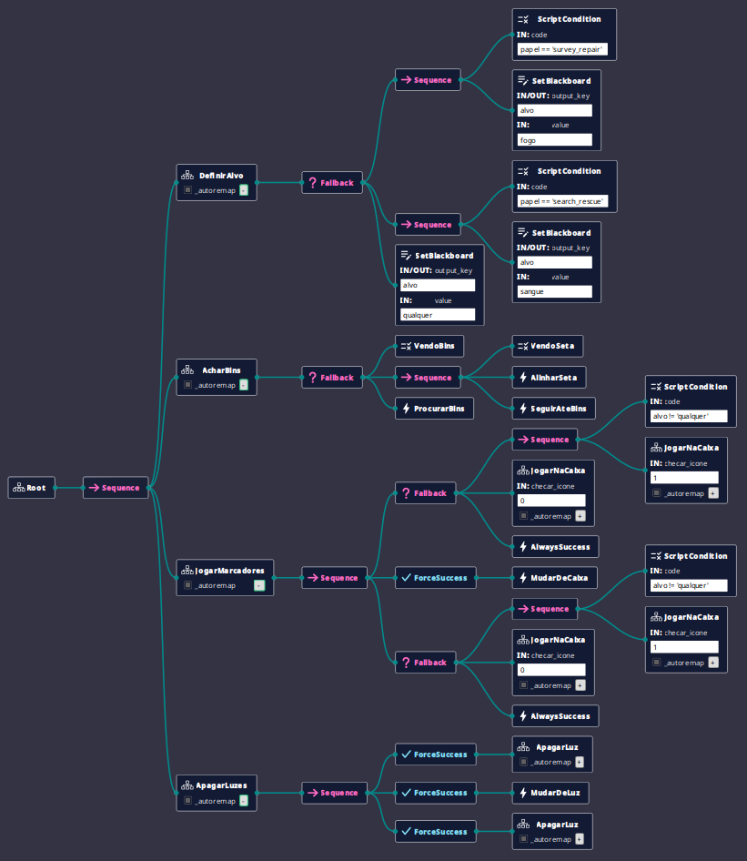

# Task 3 - Recon (Bins) | RoboSub

Behavior Tree para a Task 3 da RoboSub.

## Estrutura da Árvore

## Funcionamento

A árvore principal (`Task3`) executa quatro sub-árvores em sequência:

1. **DefinirAlvo**: Define qual ícone o robô deve procurar nas caixas de acordo com o papel recebido no início da missão.
2. **AcharBins**: Guia o robô até as caixas seguindo a seta do chão ou procurando pela área caso não estejam visíveis.
3. **JogarMarcadores**: Tenta soltar os dois marcadores nas caixas com o ícone correto. Se não conseguir identificar o ícone, solta em qualquer caixa disponível para garantir a pontuação básica.
4. **ApagarLuzes**: Aproxima o ímã do robô nos sensores para apagar as duas luzes da estrutura.

## Arquivos

- `Task3Proejct.btproj`: Projeto do Groot2.
- `task3.xml`: Definição das árvores e modelos dos nós.
